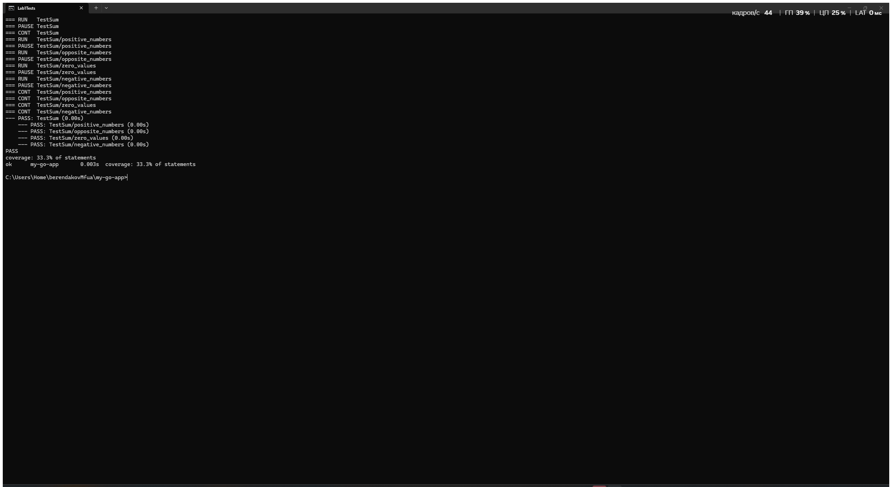
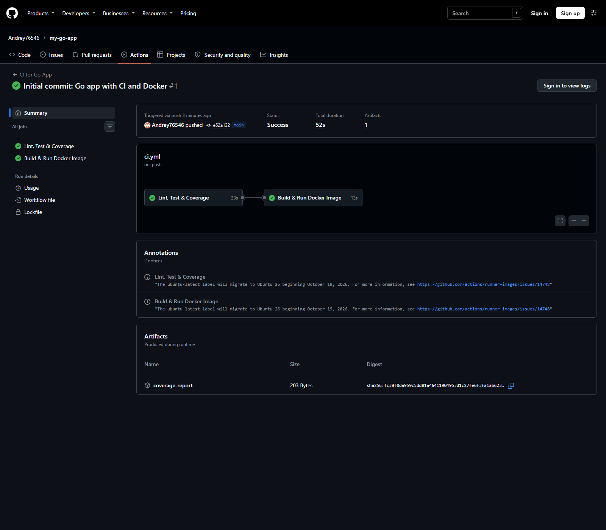
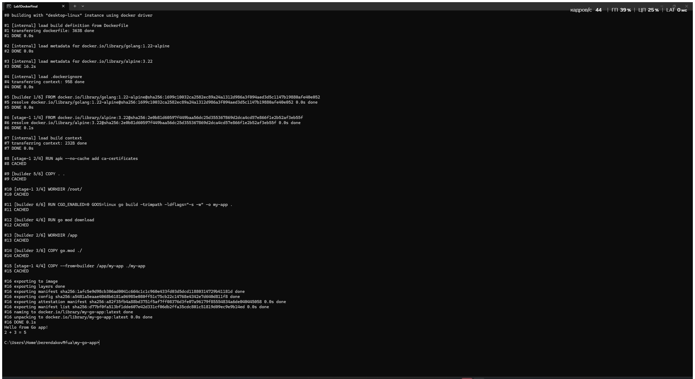

# Лабораторная работа №1 — Pipeline CI на Go

[](https://github.com/Andrey76546/my-go-app/actions/workflows/ci.yml)

## Цель

Настроить непрерывную интеграцию Go-приложения: автоматическое форматирование и линтинг, тестирование с отчётом покрытия, публикацию артефакта покрытия и проверку Docker-сборки.

## Выполнено

- реализовано консольное приложение и функция `Sum(a, b int) int`;
- добавлены табличные тесты для положительных, отрицательных и нулевых значений;
- настроены Go-модуль и двухэтапный Dockerfile;
- настроен GitHub Actions workflow с `gofmt`, `golangci-lint`, race detector, тестами и контролем покрытия;
- `coverage.out` сохраняется как артефакт workflow;
- Docker-образ собирается после успешных тестов и запускается для smoke-проверки.

## Технологии

Go 1.22, Docker, Alpine Linux, golangci-lint 2.15, GitHub Actions.

## Структура проекта

```text
my-go-app/
├── .github/workflows/ci.yml
├── screenshots/
│   ├── 01-tests.png
│   ├── 02-github-actions.png
│   └── 03-docker-build.png
├── .dockerignore
├── .gitignore
├── .golangci.yml
├── Dockerfile
├── go.mod
├── main.go
├── sum.go
└── sum_test.go
```

## Локальный запуск и проверки

Все команды выполняются из корня репозитория.

```powershell
# Тесты через Docker
docker run --rm -v "${PWD}:/app" -w /app golang:1.22-alpine go test -v -cover ./...

# Сборка бинарного файла через Docker
docker run --rm -v "${PWD}:/app" -w /app golang:1.22-alpine go build -o my-app .

# Сборка и запуск контейнера
docker build -t my-go-app:latest .
docker run --rm my-go-app:latest
```

Ожидаемый вывод приложения:

```text
Hello from Go app!
2 + 3 = 5
```

## CI

Workflow запускается для push и pull request в `main`/`master`. Job `docker-build` выполняется только для push в `main` и зависит от успешного завершения `test`.

- [Все запуски CI](https://github.com/Andrey76546/my-go-app/actions/workflows/ci.yml)
- [Контрольный успешный запуск CI](https://github.com/Andrey76546/my-go-app/actions/runs/40787889396)
- Артефакт `coverage-report` доступен на странице успешного запуска workflow.

## Результаты и доказательства

### Локальные тесты и покрытие



Тесты выполнены в официальном Docker-образе Go; показаны пройденные сценарии и итоговое покрытие.

### GitHub Actions



Оба job — `Lint, Test & Coverage` и `Build & Run Docker Image` — завершены успешно.

### Сборка и запуск Docker-образа



Образ собран локально, контейнер запущен и вывел ожидаемый результат.

## Вывод

Для проекта реализован воспроизводимый CI: изменения автоматически проверяются линтером и тестами, покрытие сохраняется как артефакт, а Docker-образ собирается и проходит smoke-проверку только после успешного CI.
